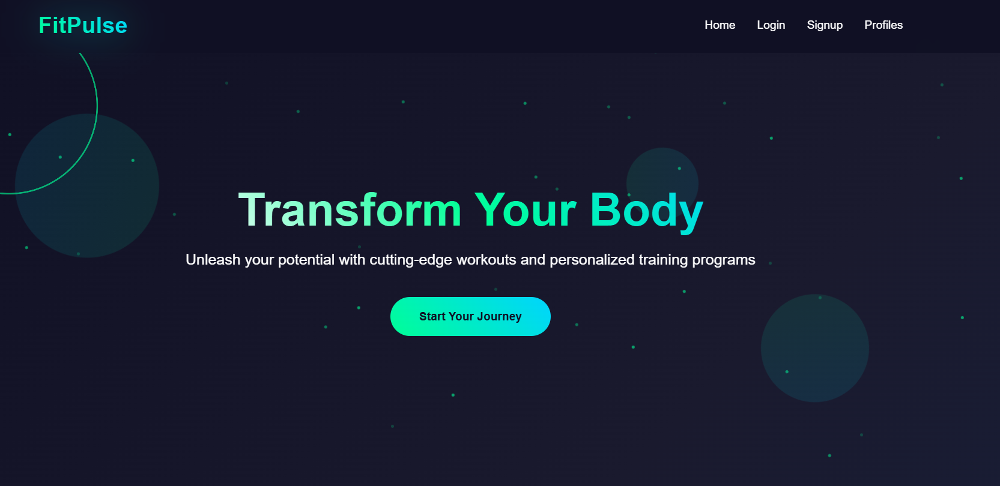
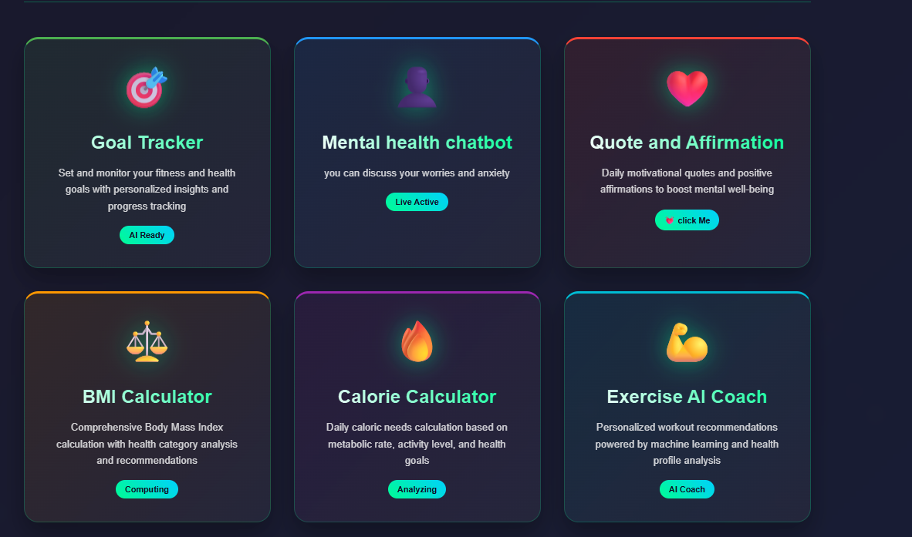
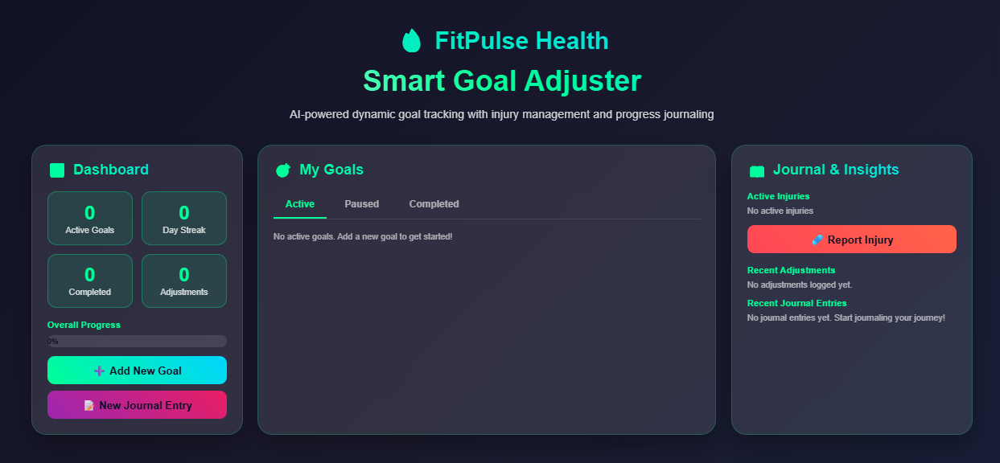
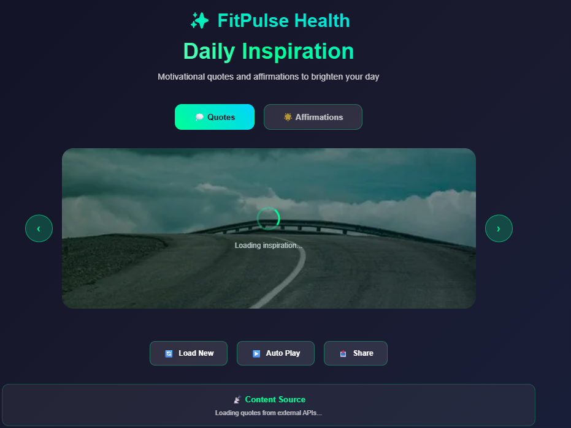

# 🏋️ FitPulse — Fitness & Health Tracking Website

FitPulse is a fitness and health-tracking web application built with **Flask (Python)** and **React.js**. It provides a user-friendly interface for managing fitness activities, organizing workouts, and tracking personal fitness goals.

## ✨ Features

- 🏠 **Interactive Dashboard** — View fitness information and activity summaries.
- 💪 **Workout Management** — Organize and manage workout routines.
- 📊 **Fitness Tracking** — Monitor activities and fitness progress.
- 🎯 **Goal Management** — Set and monitor personal fitness goals.
- 👤 **User Profiles** — Manage personal information.
- 📱 **Responsive Design** — User-friendly interface across different screen sizes.
- 🔗 **REST API Integration** — Connect the React frontend to the Flask backend.
- 🗄️ **Database Integration** — Store and manage application data.

## 📸 Screenshots

### Home Page


### Dashboard


### Workout Management


### Fitness Tracking


## 🛠️ Tech Stack

| Technology | Purpose |
|---|---|
| React.js | Frontend development |
| Flask | Backend development |
| Python | Backend logic |
| JavaScript | Interactive functionality |
| HTML5 | Web page structure |
| CSS3 | Styling and responsive design |
| REST APIs | Frontend-backend communication |
| MySQL | Database, if configured |

## 📂 Project Structure

```text
FitPulse/
├── frontend/
│   ├── public/
│   ├── src/
│   └── package.json
├── backend/
│   ├── app.py
│   └── requirements.txt
├── pic1.png
├── pic2.png
├── pic3.png
├── pic4.png
└── README.md
```

*Adjust the folder structure to match your actual project.*

## 🚀 Installation and Setup

### Prerequisites

- Python 3.10 or later
- Node.js and npm
- Git
- MySQL, if required

### 1. Clone the Repository

```bash
git clone YOUR_GITHUB_REPOSITORY_URL
cd FitPulse
```

### 2. Start the Flask Backend

```bash
cd backend
python -m venv venv
```

Activate the virtual environment on Windows:

```bash
venv\Scripts\activate
```

Install dependencies:

```bash
pip install -r requirements.txt
```

Run the backend:

```bash
python app.py
```

### 3. Start the React Frontend

Open a new terminal:

```bash
cd frontend
npm install
npm run dev
```

Open the local URL displayed in the terminal to access the website.

## 🔮 Future Enhancements

- AI-powered workout recommendations
- Nutrition and calorie tracking
- Visual fitness progress analytics
- Personalized fitness plans
- Workout reminders and notifications

## 🎯 Project Objective

FitPulse aims to make fitness management more accessible by combining a modern web interface with a Python backend to support workout organization, activity monitoring, and personal fitness goals.

## 👩‍💻 Developer

**Warda Anwar**

- GitHub: [wardaanwar2555](https://github.com/wardaanwar2555)
- LinkedIn: [Warda Anwar](https://linkedin.com/in/warda-a-729034283)

---

⭐ If you like this project, consider giving the repository a star!

